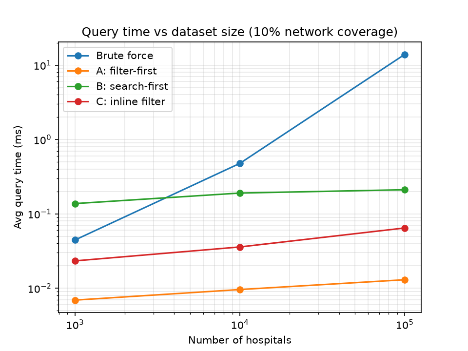
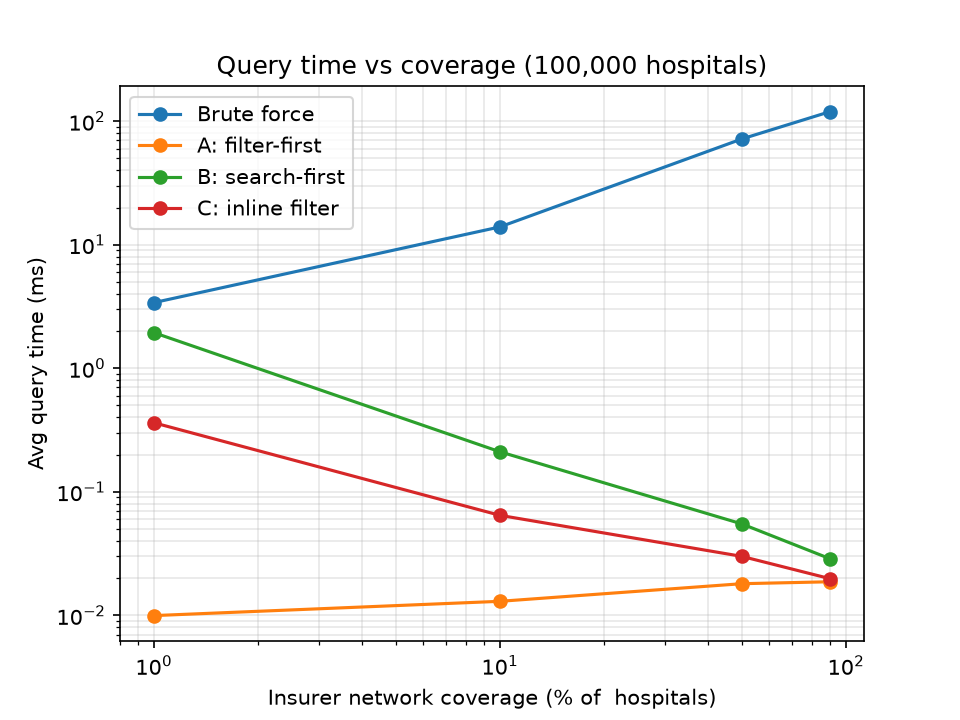
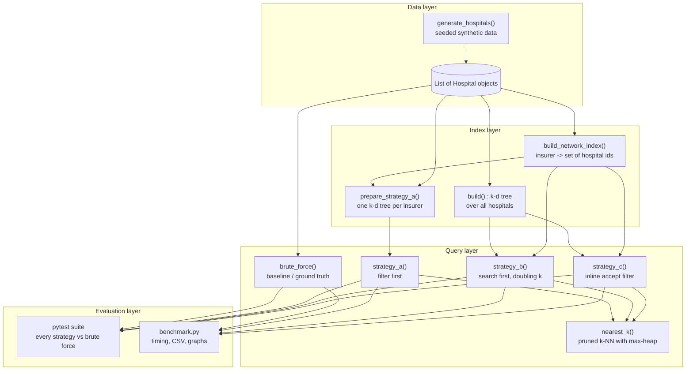
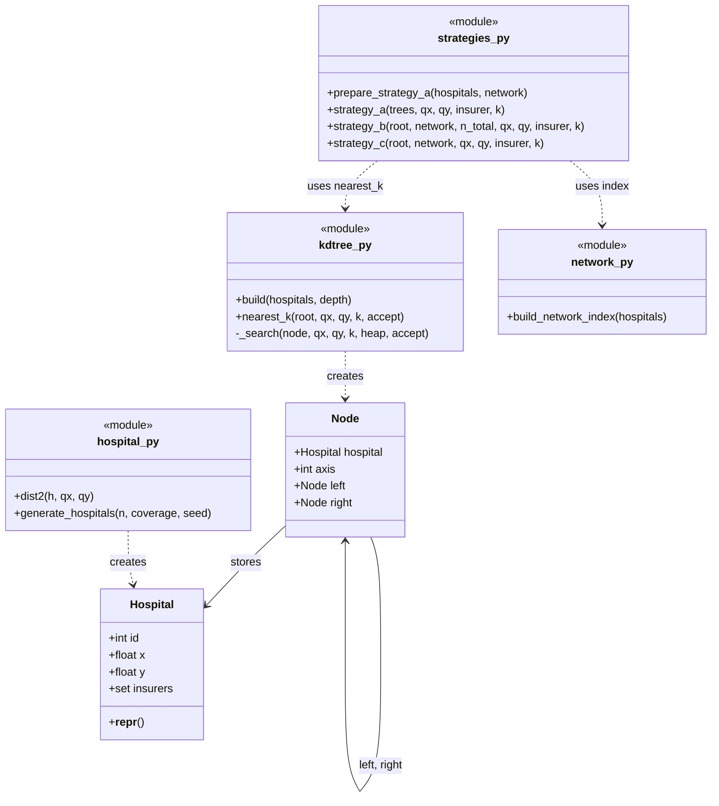
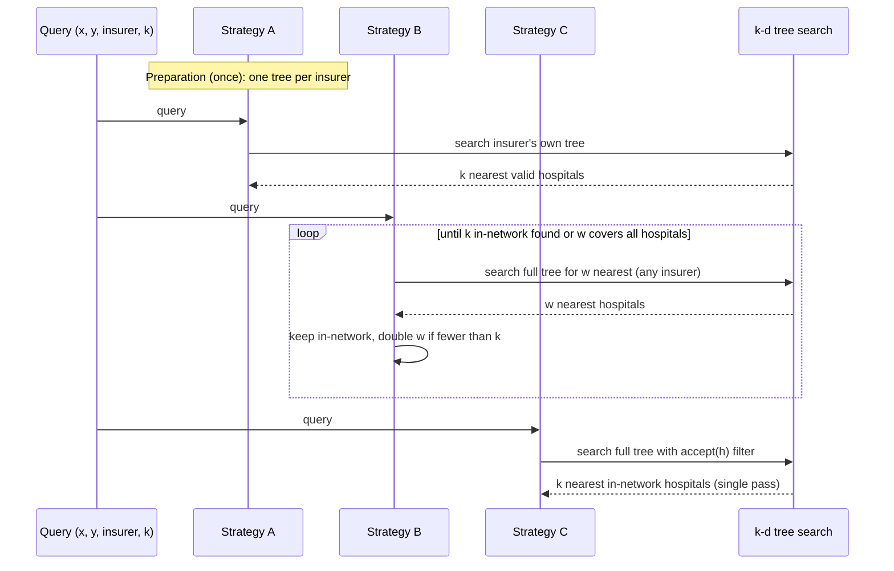

# Insurance-Aware Nearest Hospital Search

**A comparative study of filter-first, search-first and inline-filter strategies on k-d trees.**

Given a user's location and an insurer, find the **k nearest hospitals that accept that insurer cashless**, fast, and measure which search strategy works best as the hospital count and the insurer's network size change.

---

## 1. Problem

In an emergency, an insured patient needs to know which nearby hospitals accept their insurer cashless. Network lists differ by insurer and vary hugely in size.

**Formal definition**

- **Input:** a set of hospitals `H`, each `h = (id, x, y, N_h)` where `N_h` is the set of insurers `h` accepts.
- **Query:** `q = (x, y, insurer, k)`.
- **Output:** the `k` hospitals with `insurer ∈ N_h` nearest to `(x, y)`, nearest first. The answer is **exact**.

**Why it is not trivial:** brute force touches every hospital on every query. Plain nearest-neighbour search ignores the insurer, so its top results may be out of network. And the right strategy depends on how big the insurer's network is (1% to 90% of hospitals in our tests).

**Research questions**

| # | Question |
|---|---|
| RQ1 | How much faster than brute force is a k-d tree as the number of hospitals grows? |
| RQ2 | How does insurer coverage change the speed of each strategy? |
| RQ3 | Which strategy is best overall, and what extra cost does it carry? |

---

## 2. Key results

Measured on 100,000 hospitals, 200 queries per setting, k = 5 (average ms per query):

| Coverage | Brute force | A: filter-first | B: search-first | C: inline filter | A speedup vs brute |
|---|---|---|---|---|---|
| 1% | 3.399 | 0.0100 | 1.943 | 0.3625 | 341x |
| 10% | 13.94 | 0.0130 | 0.2110 | 0.0646 | 1,072x |
| 50% | 71.79 | 0.0181 | 0.0550 | 0.0300 | 3,976x |
| 90% | 119.52 | 0.0187 | 0.0287 | 0.0198 | 6,385x |

What the data shows:

- **Strategy A was fastest in all 12 settings** (3 sizes x 4 coverages).
- **Scaling:** at 10% coverage, 100x more hospitals (1k to 100k) made brute force 313x slower but Strategy A only 1.9x slower, consistent with logarithmic query cost.
- **Strategy B degrades when matches are rare:** at 1% coverage it is 195x slower than A at 100k, and slower than brute force at 1k and 10k hospitals.
- **Strategy C** sits between A and B in every setting and is within about 6% of A at 90% coverage.
- **No A-vs-B crossover in query time.** A's cost is *preparation time and memory*, not query time. A repays its setup against C after about 9 queries at 1% coverage and about 347,000 queries at 90% (100k hospitals).




---

## 3. Architecture

### 3.1 Layered view



### 3.2 Module responsibilities

| Module | File | Responsibility | Depends on |
|---|---|---|---|
| Data model and generator | `src/hospital.py` | `Hospital` class, `dist2()` squared distance, seeded `generate_hospitals()` | none |
| Baseline | `src/brute_force.py` | Scan, filter, sort, return top k. Ground truth for all tests | `hospital` |
| k-d tree | `src/kdtree.py` | `Node`, recursive `build()`, pruned `nearest_k()` with optional `accept` filter | `hospital` |
| Network index | `src/network.py` | `build_network_index()`: dict of insurer to set of ids | none |
| Strategies | `src/strategies.py` | `strategy_a`, `strategy_b`, `strategy_c` and Strategy A's preparation step | `kdtree` |
| Benchmark | `src/benchmark.py` | Times all methods, checks correctness first, writes `results.csv` and graphs | all of the above |

The dependency direction is one-way (data, then index, then query, then evaluation). Nothing in `src/` imports from `tests/` or from the benchmark.

### 3.3 Class and function view



### 3.4 Query flow of each strategy



### 3.5 Example k-d tree (7 hospitals)

Points `(2,3) (5,4) (9,6) (4,7) (8,1) (7,2) (6,9)`. Split on x at depth 0, y at depth 1, always at the median:

```
                 (6,9)  split x
               /         \
        (5,4) split y    (7,2) split y
        /      \          /      \
    (2,3)    (4,7)     (8,1)    (9,6)
```

---

## 4. Data structures and why

| Structure | Where used | Why this one |
|---|---|---|
| **k-d tree** (binary tree, alternating x/y splits at the median) | Spatial index in `kdtree.py` | Static, in-memory 2D points; O(n) space; balanced depth about log2 n; exact k-NN with simple branch pruning. Easy to implement and explain |
| **Bounded max-heap** (size k) | Inside `nearest_k` | Root is the worst of the best k, so the pruning test is one O(1) comparison; update costs O(log k). Python's `heapq` is a min-heap, so distances are stored negated |
| **Hash map of sets** | `network.py` | O(1) "is hospital in this insurer's network?" for Strategies B and C; also gives Strategy A its hospital list |
| **Set** for `Hospital.insurers` | `hospital.py` | O(1) average membership, no duplicate insurers. A list would scan |

**Why a k-d tree and not something else**

| Alternative | Why not here |
|---|---|
| R-tree | Designed for rectangles, disk pages and frequent updates. Overlapping bounding boxes complicate exact pruning. A good choice for disk-resident or heavily updated data, which this is not |
| Quadtree | Splits space, not data, so it is unbalanced on clustered data |
| Uniform grid | Needs tuned cell size; k-NN ring search gets awkward |
| Learned index | Needs training; recent evaluations focus on range queries; hard to explain |
| Brute force | O(n) per query; kept as the baseline |

**Why sets, not lists:** Strategies B and C test insurer membership for every candidate they visit. A list makes each test up to O(n), which would cancel the tree's logarithmic gain.

---

## 5. Algorithms

### 5.1 Squared distance

`dist2 = dx² + dy²` ranks hospitals in exactly the same order as true distance without the square root. The root is taken only when printing for a human.

### 5.2 k-d tree build

```
build(points, depth):
    if no points: return None
    axis = depth mod 2                    # 0 = x, 1 = y
    sort points by that axis
    mid = middle index                    # median keeps the tree balanced
    return Node(points[mid], axis,
                left  = build(points before mid, depth+1),
                right = build(points after mid,  depth+1))
```

### 5.3 Pruned k-NN search (`nearest_k`)

```
search(node, query, k, heap, accept):
    if node is None: return
    if accept is None or accept(node.hospital):
        push node.hospital into heap          # keep only the best k
    diff = query coordinate - node's split coordinate (on node.axis)
    near, far = (left, right) if diff < 0 else (right, left)
    search(near)                               # likely holds good candidates
    if heap has fewer than k OR diff² < worst distance in heap:
        search(far)                            # otherwise: PRUNE the whole branch
```

**Pruning in one sentence:** every point on the far side of a splitting line is at least `|diff|` away, so if `diff²` is not smaller than our current worst of k, nothing there can improve the answer and the entire subtree is skipped.

Worked example (k = 1, query `(8.5, 2)` on the 7-point tree above): the search visits `(6,9)`, then `(7,2)`, then `(8,1)` (best, distance² 1.25). Back at the root the far-side bound is `2.5² = 6.25 > 1.25`, so the whole left subtree is skipped: 3 of 7 hospitals are never examined.

### 5.4 Three constrained strategies

| | A: filter first | B: search first | C: inline filter |
|---|---|---|---|
| Idea | Pre-build a tree per insurer, containing only its hospitals | Search the full tree, then discard out-of-network results; double the search size and repeat if short | One search of the full tree; only in-network hospitals enter the heap |
| Preparation | One k-d tree per insurer | None (reuses one tree) | None (reuses one tree) |
| Correctness argument | The tree holds exactly the valid hospitals | If k in-network hospitals are among the w nearest, any closer in-network hospital would also be among them | Out-of-network hospitals can never enter the heap |
| Weakness | Build time and memory per insurer; rebuild if a network changes | Rare insurers need large w and repeated searches | Pruning is loose until k matches have been found |
| Strength | Fastest queries; every visited node is useful | No extra memory | No retries, no extra tree |

```
strategy_b(root, network, n_total, q, insurer, k):
    ids = network[insurer]
    w = k
    loop:
        candidates = nearest_k(root, q, w)             # any insurer
        good = [c in candidates if c.id in ids]
        if len(good) >= k or w >= n_total: return good[:k]
        w = w * 2
```

---

## 6. Complexity

`n` = hospitals, `m = p·n` = matching hospitals, `p` = coverage fraction, `k` = results wanted.

| Operation | Time | Why |
|---|---|---|
| Brute force query | O(n + m log m) | Scans all hospitals, sorts all matches |
| k-d tree build | O(n log² n) | Sorts at each of about log n levels (O(n log n) with a linear-time median finder) |
| k-d tree k-NN query | O(log n + k) average, O(n) worst | One descent of about log2 n levels, plus pruning. Average-case on evenly spread points |
| Insurer index build | O(total insurer-hospital pairs) | One pass over all hospitals |
| Membership check | O(1) average | Hash lookup |
| Strategy A query | O(log m + k) average | Tree holds only matching hospitals |
| Strategy B query | grows roughly as 1/p | About k/p nearest hospitals must be examined to find k matches; doubling re-searches from scratch |
| Strategy C query | between A and B (measured) | One pass, but the heap is not full until k matches are found |

Space: O(n) for the main tree and the hospital list, plus O(total insurer-hospital pairs) for the index, plus O(Σ mᵢ) for Strategy A's per-insurer trees.

---

## 7. Project structure

```
hospital_search/
├── src/
│   ├── __init__.py
│   ├── hospital.py        # Hospital, dist2, generate_hospitals          (Module 0)
│   ├── brute_force.py     # baseline search                               (Module 1)
│   ├── kdtree.py          # Node, build, nearest_k, _search               (Module 2)
│   ├── network.py         # build_network_index                           (Module 3)
│   ├── strategies.py      # strategy_a / strategy_b / strategy_c          (Module 4)
│   └── benchmark.py       # timing, results.csv, graphs                   (Module 5)
├── tests/
│   ├── __init__.py
│   ├── test_hospitals.py
│   ├── test_brute_force.py
│   ├── test_kdtree.py
│   ├── test_network.py
│   └── test_strategies.py
├── docs/
│   ├── journal.md         # implementation log: what, why, problems hit
│   └── decisions.md       # key design decisions with alternatives
├── explore.py             # scratch script: prints data and draws the hospital map
├── main.py                # optional command-line demo
├── results.csv            # generated by the benchmark
├── graph_size.png         # generated by the benchmark
├── graph_coverage.png     # generated by the benchmark
├── requirements.txt
└── README.md
```

`requirements.txt`:

```
matplotlib
pytest
```

---

## 8. Setup and usage

All commands are run from the project root (`hospital_search/`).

**Setup (Windows)**

```bash
python -m venv venv
venv\Scripts\activate
pip install -r requirements.txt
```

**Setup (macOS / Linux)**

```bash
python3 -m venv venv
source venv/bin/activate
pip install -r requirements.txt
```

**Run the tests**

```bash
python -m pytest -v
```

**Look at the generated data** (prints sample hospitals and network sizes, saves `hospital_map.png`)

```bash
python explore.py
```

**Run the benchmark** (takes a few minutes; writes `results.csv`, `graph_size.png`, `graph_coverage.png`)

```bash
python -m src.benchmark
```

**Use the library directly**

```python
from src.hospital import generate_hospitals
from src.kdtree import build
from src.network import build_network_index
from src.strategies import strategy_c

coverage = {"Star": 0.30, "HDFC": 0.10, "Niva": 0.02}   # P(a hospital accepts the insurer)
hospitals = generate_hospitals(10_000, coverage, seed=42)
network   = build_network_index(hospitals)
root      = build(hospitals)

# 5 nearest hospitals to (50 km, 50 km) that accept "Star"
for d2, h in strategy_c(root, network, 50, 50, "Star", 5):
    print(h, f"{d2 ** 0.5:.2f} km")
```

**Optional command-line demo**

```bash
python main.py
```

---

## 9. Testing strategy

Principle: **correctness first, speed second.** The brute-force method is simple enough to verify by eye, so every faster method is checked against it. Nothing is timed until it passes.

| Test file | What it checks |
|---|---|
| `test_hospitals.py` | Correct count; same seed gives identical data; coverage is statistically close to requested (within 5 standard deviations) |
| `test_brute_force.py` | Hand-computed 5-hospital example; fewer than k matches returns fewer; unknown insurer returns empty |
| `test_kdtree.py` | 1,000 random queries match brute force; k larger than n; empty tree |
| `test_network.py` | Index agrees with each hospital's own insurer set |
| `test_strategies.py` | A, B and C match brute force on 300 queries at four coverage levels (0.5%, 5%, 50%, 95%); unknown insurer returns empty for all |

Two details that prevent false failures:

- **Ties:** two hospitals can be at the same distance. Tests compare the **list of distances**, never hospital ids.
- **Random data:** coverage tests use a statistical range, not an exact count.

The benchmark also re-verifies 30 queries per setting before timing.

---

## 10. Benchmark methodology and full results

**Setup**

| Parameter | Value |
|---|---|
| Hospitals | 1,000 / 10,000 / 100,000 |
| Insurer coverage | 1% / 10% / 50% / 90% |
| Queries | 200 random points per setting, same points for every method |
| k | 5 |
| Data seed | 42 (query seed 123) |
| Timer | `time.perf_counter()` |
| Reported value | Average milliseconds per query |

Tree build, insurer-index build and Strategy A preparation are timed separately because they are one-time costs.

**Metrics:** average query time, speedup over brute force, throughput (1000 / ms), scaling factor (time at 100k divided by time at 1k), preparation cost, break-even queries (A's preparation time divided by its per-query saving over C), and exact-match correctness.

**Full per-query results (ms)**

| Hospitals | Coverage | Brute force | A | B | C |
|---|---|---|---|---|---|
| 1,000 | 1% | 0.0240 | 0.0046 | 0.7546 | 0.0929 |
| 1,000 | 10% | 0.0445 | 0.0069 | 0.1374 | 0.0233 |
| 1,000 | 50% | 0.1461 | 0.0083 | 0.0329 | 0.0121 |
| 1,000 | 90% | 0.2452 | 0.0095 | 0.0155 | 0.0103 |
| 10,000 | 1% | 0.1864 | 0.0071 | 1.5152 | 0.2037 |
| 10,000 | 10% | 0.4772 | 0.0096 | 0.1904 | 0.0359 |
| 10,000 | 50% | 3.5169 | 0.0117 | 0.0399 | 0.0148 |
| 10,000 | 90% | 6.8647 | 0.0132 | 0.0233 | 0.0157 |
| 100,000 | 1% | 3.3986 | 0.0100 | 1.9431 | 0.3625 |
| 100,000 | 10% | 13.9388 | 0.0130 | 0.2110 | 0.0646 |
| 100,000 | 50% | 71.7915 | 0.0181 | 0.0550 | 0.0300 |
| 100,000 | 90% | 119.5175 | 0.0187 | 0.0287 | 0.0198 |

**One-time costs at 100,000 hospitals:** k-d tree build about 0.33 to 0.39 s; Strategy A preparation 0.003 s (1% coverage) to 0.38 s (90%); network index 0.004 to 0.011 s.

**Break-even for Strategy A against C (100,000 hospitals):** about 9 queries (1% coverage), 424 (10%), 12,892 (50%), 347,481 (90%).

*Measured on the author's machine (Windows, Python 3.12). Absolute numbers will differ on other hardware; the ordering and trends are what matter.*

---

## 11. Design decisions

| Decision | Alternatives considered | Reason |
|---|---|---|
| Generate data in memory from a seed | JSON/CSV file of hospitals | Benchmark needs many sizes and coverages; the seed gives the same reproducibility; Python sets are not directly JSON-serialisable |
| Flat 100 x 100 km plane | Latitude/longitude with haversine distance | Keeps the distance formula and the k-d tree simple; a deliberate simplification |
| Squared distance for ranking | True Euclidean distance | Same ordering, no square root |
| Compare distances in tests, not ids | Compare id lists | Equal-distance ties would cause false failures |
| `accept` callback inside `nearest_k` | Separate filtered tree-walk | One search routine serves plain k-NN and Strategy C |
| Doubling in Strategy B | Increase w by a fixed step | Total work stays within a small multiple of the final search |
| Strategy C added beyond the original two | Only A vs B | Gives a one-tree, one-pass option, and it turned out to be the best single-tree choice |

---

## 12. Limitations

- **Synthetic, evenly spread data** on a flat plane. Real hospitals cluster in cities, which can weaken k-d tree pruning, so real-world speedups may be smaller.
- **Single insurer per benchmark run.** Strategy A's total memory across many insurers was not measured.
- **Static tree.** Changing hospital data means rebuilding.
- **Pure Python timings.** Absolute numbers would differ in a compiled language.
---

